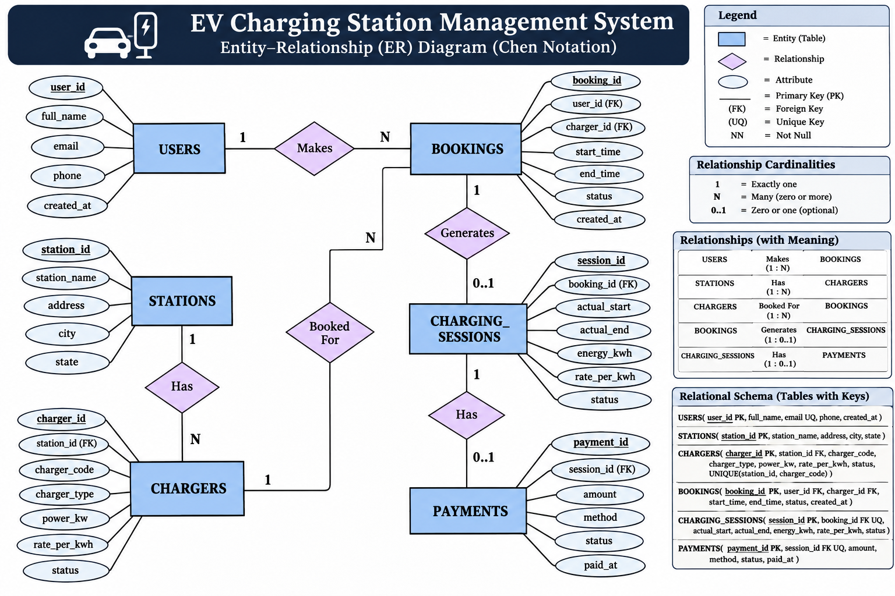

# Table of Contents

# Abstract

The EV Charging Station Management System is a MySQL database project for organizing drivers, station locations, chargers, reservations, charging sessions and payments. Six related tables model the operational lifecycle. Primary and foreign keys preserve identity and references, while unique and check constraints restrict invalid records. Stored procedures coordinate booking, session initiation, charging completion, bill calculation and payment status updates. Triggers support time validation, tariff capture and status synchronization. Views and SQL queries expose reservation history, energy consumption and revenue.

The project demonstrates relational design, normalization, joins, aggregation and transaction processing through MySQL Workbench. It is a database implementation rather than a deployed web application. This report presents the architecture, supplied ER diagram, representative implementation code and a reproducible usage sequence. Static calculations from the sample data are distinguished from historical test summaries. Implementation limitations include incomplete lifecycle validation, direct SQL bypass of procedural rules and a summary count that requires correction.

Keywords — MySQL, EV charging, relational database, normalization, stored procedures.

# 1 Introduction

## 1.1 About the Project

A charging station contains several charging units with different power ratings and prices. A driver books a unit for a time interval, charging records the actual energy delivered, and payment records describe the resulting invoice. These facts must remain connected without repeatedly storing user contact details or station addresses in every transaction.

The proposed database maintains a traceable chain from a reservation to its session and payment. It separates station infrastructure from transactional activity so that a station or charger can exist before its first booking. The project uses SQL scripts, MySQL InnoDB and MySQL Workbench.

## 1.2 Problem Statement and Objectives

The problem is to organize charging reservations and billing records while preserving referential integrity and supporting useful reports. The objectives are to manage users and chargers, validate reservation intervals, capture session prices, calculate bills, record payment states and demonstrate retrieval through simple and advanced SQL.

## 1.3 Scope and Expected Outcomes

The implementation contains six core tables, four triggers, six stored procedures, five views and 32 demonstration queries. Students can use it to explain schema design, primary and foreign keys, 3NF, transactions, joins and aggregate functions. Hardware integration, online banking, map services and a mobile interface are outside the implemented scope.

# 2 Data Base System Design

## 2.1 System Architecture and Modules

| Module | Responsibility |
|---|---|
| User and infrastructure | users, stations and chargers store identities, locations and tariffs |
| Reservation | bookings stores intervals and reservation state |
| Charging | charging_sessions stores actual time, energy and rate snapshot |
| Payment | payments stores invoice amount and settlement state |
| Reporting | Views and queries combine operational and financial records |

The operator issues SQL in Workbench or the mysql client. Stored procedures coordinate multi statement changes, InnoDB stores the related records, and views return tabular results. The workflow is select charger, reserve slot, start session, complete charging, record payment and review reports.

## 2.2 Relationships and Integrity

| Parent and child | Cardinality |
|---|---|
| users to bookings | 1 to 0..N |
| stations to chargers | 1 to 0..N |
| chargers to bookings | 1 to 0..N |
| bookings to charging_sessions | 1 to 0..1 |
| charging_sessions to payments | 1 to 0..1 |

Each child has a nonnullable foreign key. All foreign keys use ON DELETE RESTRICT and ON UPDATE CASCADE. Unique booking_id in sessions and unique session_id in payments enforce the optional one to one links. The charger code is unique within a station.

## 2.3 Entity Relationship Diagram



Figure 1 Entity Relationship Diagram in Chen Notation

The supplied diagram contains all 37 columns of the six core entities. Rectangles represent entities, ovals represent attributes and diamonds represent relationships. Primary keys are underlined. The diagram also identifies foreign keys, unique keys and relationship cardinalities.

## 2.4 Normalization

The schema uses atomic column values for 1NF. Nonkey attributes depend on the complete candidate key, satisfying 2NF under the modeled dependencies. Separating user, station and charger facts avoids nonkey transitive dependencies in transaction tables, supporting 3NF. A surrogate identifier alone is not proof of normalization; alternate candidate keys include users.email and the station_id plus charger_code pair.

The session tariff records a historical price, distinct from the current charger rate. Direct SQL can still edit this snapshot; the ledger is not immutable.

# 3 Implementation

## 3.1 Interface and Setup

Open an authorized MySQL Workbench connection. Use File > Open SQL Script and run scripts 01 through 06 in 02_SQL_Scripts in numerical order. Refresh the Schemas panel to inspect ev_charging_management. Run 03_Sample_Data/01_seed_data.sql only for a disposable demonstration dataset because it truncates the core tables. The index script cannot be rerun unchanged after its index names exist.

```sql
CREATE DATABASE IF NOT EXISTS ev_charging_management;
USE ev_charging_management;
SELECT DATABASE(), VERSION();
SHOW TABLES;
SHOW TRIGGERS;
```

In the mysql command line, start the client from the project root and use SOURCE 02_SQL_Scripts/08_full_project_setup.sql for a fresh setup. In Workbench, execute the component files individually. The master script also runs the destructive seed operation.

## 3.2 Table Creation

The complete six table definitions below are taken from the implemented schema. They show types, keys, defaults and checks directly, following the sample case study’s code focused approach.

### users

```sql
CREATE TABLE IF NOT EXISTS users (
  user_id INT AUTO_INCREMENT PRIMARY KEY,
  full_name VARCHAR(100) NOT NULL,
  email VARCHAR(120) NOT NULL UNIQUE,
  phone VARCHAR(15) NOT NULL,
  created_at DATETIME NOT NULL DEFAULT CURRENT_TIMESTAMP,
  CONSTRAINT chk_user_email_format CHECK (email LIKE '%_@__%.__%')
  ) ENGINE=InnoDB DEFAULT CHARSET=utf8mb4
COLLATE=utf8mb4_unicode_ci;
```

### stations

```sql
CREATE TABLE IF NOT EXISTS stations (
  station_id INT AUTO_INCREMENT PRIMARY KEY,
  station_name VARCHAR(100) NOT NULL,
  address VARCHAR(255) NOT NULL,
  city VARCHAR(80) NOT NULL,
  state VARCHAR(80) NOT NULL
  ) ENGINE=InnoDB DEFAULT CHARSET=utf8mb4
COLLATE=utf8mb4_unicode_ci;
```

### chargers

```sql
CREATE TABLE IF NOT EXISTS chargers (
  charger_id INT AUTO_INCREMENT PRIMARY KEY,
  station_id INT NOT NULL,
  charger_code VARCHAR(20) NOT NULL,
  charger_type ENUM('AC', 'DC') NOT NULL,
  power_kw DECIMAL(6,2) NOT NULL,
  rate_per_kwh DECIMAL(8,2) NOT NULL,
  status ENUM('ACTIVE', 'MAINTENANCE', 'OUT_OF_SERVICE') NOT NULL DEFAULT 'ACTIVE',
  CONSTRAINT fk_chargers_station 
  FOREIGN KEY (station_id) REFERENCES stations(station_id) 
  ON DELETE RESTRICT ON UPDATE CASCADE,
  CONSTRAINT uk_station_charger_code 
  UNIQUE (station_id, charger_code),
  CONSTRAINT chk_charger_power 
  CHECK (power_kw > 0.00),
  CONSTRAINT chk_charger_rate 
  CHECK (rate_per_kwh >= 0.00)
  ) ENGINE=InnoDB DEFAULT CHARSET=utf8mb4
COLLATE=utf8mb4_unicode_ci;
```

### bookings

```sql
CREATE TABLE IF NOT EXISTS bookings (
  booking_id INT AUTO_INCREMENT PRIMARY KEY,
  user_id INT NOT NULL,
  charger_id INT NOT NULL,
  start_time DATETIME NOT NULL,
  end_time DATETIME NOT NULL,
  status ENUM('PENDING', 'CONFIRMED', 'CANCELLED', 'COMPLETED') NOT NULL DEFAULT 'PENDING',
  created_at DATETIME NOT NULL DEFAULT CURRENT_TIMESTAMP,
  CONSTRAINT fk_bookings_user 
  FOREIGN KEY (user_id) REFERENCES users(user_id) 
  ON DELETE RESTRICT ON UPDATE CASCADE,
  CONSTRAINT fk_bookings_charger 
  FOREIGN KEY (charger_id) REFERENCES chargers(charger_id) 
  ON DELETE RESTRICT ON UPDATE CASCADE,
  CONSTRAINT chk_booking_time_order 
  CHECK (end_time > start_time)
  ) ENGINE=InnoDB DEFAULT CHARSET=utf8mb4
COLLATE=utf8mb4_unicode_ci;
```

### charging_sessions

```sql
CREATE TABLE IF NOT EXISTS charging_sessions (
  session_id INT AUTO_INCREMENT PRIMARY KEY,
  booking_id INT NOT NULL UNIQUE,
  actual_start DATETIME NOT NULL,
  actual_end DATETIME NULL,
  energy_kwh DECIMAL(8,3) NULL,
  rate_per_kwh DECIMAL(8,2) NOT NULL,
  status ENUM('IN_PROGRESS', 'COMPLETED') NOT NULL DEFAULT 'IN_PROGRESS',
  CONSTRAINT fk_sessions_booking 
  FOREIGN KEY (booking_id) REFERENCES bookings(booking_id) 
  ON DELETE RESTRICT ON UPDATE CASCADE,
  CONSTRAINT chk_session_time_order 
  CHECK (actual_end IS NULL OR actual_end >= actual_start),
  CONSTRAINT chk_session_energy 
  CHECK (energy_kwh IS NULL OR energy_kwh >= 0.000),
  CONSTRAINT chk_session_rate 
  CHECK (rate_per_kwh >= 0.00)
  ) ENGINE=InnoDB DEFAULT CHARSET=utf8mb4
COLLATE=utf8mb4_unicode_ci;
```

### payments

```sql
CREATE TABLE IF NOT EXISTS payments (
  payment_id INT AUTO_INCREMENT PRIMARY KEY,
  session_id INT NOT NULL UNIQUE,
  amount DECIMAL(10,2) NOT NULL,
  method ENUM('UPI', 'CARD', 'CASH') NULL,
  status ENUM('PENDING', 'COMPLETED', 'FAILED') NOT NULL DEFAULT 'PENDING',
  paid_at DATETIME NULL,
  CONSTRAINT fk_payments_session 
  FOREIGN KEY (session_id) REFERENCES charging_sessions(session_id) 
  ON DELETE RESTRICT ON UPDATE CASCADE,
  CONSTRAINT chk_payment_amount 
  CHECK (amount >= 0.00)
  ) ENGINE=InnoDB DEFAULT CHARSET=utf8mb4
COLLATE=utf8mb4_unicode_ci;
```

## 3.3 Insertion of Sample Values

The original seed contains 20 users, 8 stations, 24 chargers, 60 bookings, 30 sessions and 25 payments. The following connected rows are extracted from that seed. They illustrate the data; do not insert them again into an already seeded database because their keys already exist.

```sql
INSERT INTO users (user_id, full_name, email, phone, created_at)
VALUES (1,  'Aarav Sharma',     'aarav.sharma@example.in',     '+919876543210', '2026-10-01 09:15:00');
```

```sql
INSERT INTO stations (station_id, station_name, address, city, state)
VALUES (1, 'Gachibowli FastHub EV',        'Plot 45, Financial District, Gachibowli',   'Hyderabad',  'Telangana');
```

```sql
INSERT INTO chargers (charger_id, station_id, charger_code, charger_type, power_kw, rate_per_kwh, status)
VALUES (2,  1, 'GB-DC-01',  'DC', 60.00,  19.50, 'ACTIVE');
```

```sql
INSERT INTO bookings (booking_id, user_id, charger_id, start_time, end_time, status, created_at)
VALUES (1,  1,  2,  '2026-11-01 08:00:00', '2026-11-01 09:00:00', 'COMPLETED', '2026-10-31 18:00:00');
```

```sql
INSERT INTO charging_sessions (session_id, booking_id, actual_start, actual_end, energy_kwh, rate_per_kwh, status)
VALUES (1,  1,  '2026-11-01 08:02:10', '2026-11-01 08:58:30', 42.500, 19.50, 'COMPLETED');
```

```sql
INSERT INTO payments (payment_id, session_id, amount, method, status, paid_at)
VALUES (1,  1,  828.75,  'UPI',  'COMPLETED', '2026-11-01 09:05:00');
```

## 3.4 Simple SQL Queries and Joins

```sql
SELECT * FROM stations ORDER BY state, city;
SELECT charger_code, power_kw, rate_per_kwh
FROM chargers
WHERE status='ACTIVE' AND charger_type='DC'
ORDER BY power_kw DESC;
```

Selection and ordering list stations and operational fast chargers. Operational status alone does not establish that a requested reservation interval is free.

```sql
SELECT b.booking_id, u.full_name, c.charger_code,
       s.station_name, b.start_time, b.status
FROM bookings b
JOIN users u ON b.user_id=u.user_id
JOIN chargers c ON b.charger_id=c.charger_id
JOIN stations s ON c.station_id=s.station_id;
```

The join retrieves customer, charger and station context through foreign keys without copying those fields into the booking table.

## 3.5 Aggregate Functions and Subquery

```sql
SELECT c.charger_type, COUNT(*) AS session_count,
 SUM(cs.energy_kwh) AS total_kwh, AVG(cs.energy_kwh) AS avg_kwh,
 MIN(cs.energy_kwh) AS min_kwh, MAX(cs.energy_kwh) AS max_kwh
FROM charging_sessions cs
JOIN bookings b ON cs.booking_id=b.booking_id
JOIN chargers c ON b.charger_id=c.charger_id
WHERE cs.status='COMPLETED'
GROUP BY c.charger_type
HAVING SUM(cs.energy_kwh)>50;

SELECT charger_code, rate_per_kwh FROM chargers
WHERE rate_per_kwh > (SELECT AVG(rate_per_kwh) FROM chargers);
```

WHERE filters rows before grouping, while HAVING filters groups. The scalar subquery supplies the mean catalog price. The complete query collection additionally demonstrates CTEs, DENSE_RANK, LAG and EXPLAIN.

## 3.6 Trigger Implementation

The session completion trigger updates its booking when the session changes to COMPLETED. The booking insert trigger rejects reversed intervals. These are actual source definitions; no trigger prevents overlapping bookings.

```sql
DELIMITER $$
CREATE TRIGGER trg_bookings_before_insert
BEFORE INSERT ON bookings
FOR EACH ROW
BEGIN
    IF NEW.end_time <= NEW.start_time THEN
        SIGNAL SQLSTATE '45000'
            SET MESSAGE_TEXT = 'Validation Error: Booking end_time must be strictly after start_time.';
    END IF;
END$$
DELIMITER ;
```

```sql
DELIMITER $$
CREATE TRIGGER trg_sessions_after_update
AFTER UPDATE ON charging_sessions
FOR EACH ROW
BEGIN
    IF NEW.status = 'COMPLETED' AND OLD.status != 'COMPLETED' THEN
        UPDATE bookings
        SET status = 'COMPLETED'
        WHERE booking_id = NEW.booking_id;
    END IF;
END$$
DELIMITER ;
```

The remaining triggers supply session tariffs when required and payment completion timestamps. They do not make rates immutable or automatically generate invoices for direct INSERT operations.

## 3.7 Stored Procedure and Reporting

sp_calculate_bill joins session, reservation, driver, charger and station information. Its OUT parameters return a bill breakdown. This definition is included as a complete stored procedure example.

```sql
DELIMITER $$
CREATE PROCEDURE sp_calculate_bill(
    IN  p_session_id     INT,
    OUT p_user_name      VARCHAR(100),
    OUT p_station_name   VARCHAR(100),
    OUT p_charger_code   VARCHAR(20),
    OUT p_energy_kwh     DECIMAL(8,3),
    OUT p_rate_per_kwh   DECIMAL(8,2),
    OUT p_total_amount   DECIMAL(10,2)
)
BEGIN
    SELECT 
        u.full_name,
        st.station_name,
        ch.charger_code,
        cs.energy_kwh,
        cs.rate_per_kwh,
        ROUND(IFNULL(cs.energy_kwh, 0.000) * cs.rate_per_kwh, 2)
    INTO 
        p_user_name,
        p_station_name,
        p_charger_code,
        p_energy_kwh,
        p_rate_per_kwh,
        p_total_amount
    FROM charging_sessions cs
    JOIN bookings b   ON cs.booking_id = b.booking_id
    JOIN users u      ON b.user_id = u.user_id
    JOIN chargers ch  ON b.charger_id = ch.charger_id
    JOIN stations st  ON ch.station_id = st.station_id
    WHERE cs.session_id = p_session_id;
END$$
DELIMITER ;
```

```sql
CALL sp_calculate_bill(1, @user, @station, @charger,
 @kwh, @rate, @total);
SELECT @user, @station, @charger, @kwh, @rate, @total;
CALL sp_station_revenue_report(NULL);
```

## 3.8 End to End Demonstration

Use a disposable database and run one call at a time. Confirm the user and charger exist, select a free interval, and continue only when the preceding status is SUCCESS. These calls illustrate operation; they were not executed during report preparation.

```sql
CALL sp_book_charger_slot(1,2,
 '2026-11-21 10:00:00','2026-11-21 11:00:00',
 @booking,@status,@message);
SELECT @booking,@status,@message;
CALL sp_start_charging_session(@booking,
 @session,@status,@message);
SELECT @session,@status,@message;
CALL sp_complete_charging_session(@session,10.000,
 @amount,@status,@message);
SELECT @amount,@status,@message;
CALL sp_process_payment(@session,'UPI','COMPLETED',
 @status,@message);
SELECT @status,@message;
SELECT * FROM vw_payment_audit_log
WHERE session_id=@session;
```

Booking validates the user and charger and checks overlap. Start captures a tariff. Completion records energy and creates a pending invoice. Payment processing records a simulated settlement state without contacting a bank. Procedures manage transactions and roll back on SQL errors.

## 3.9 Results and Testing

| Metric | Value from seed source |
|---|---|
| Core table row counts | 20 users; 8 stations; 24 chargers; 60 bookings; 30 sessions; 25 payments |
| Completed payments | 20 |
| Completed payment total | INR 19,779.73 |
| Session 1 bill | 42.500 kWh × INR 19.50 = INR 828.75 |

These figures are static calculations from INSERT values, not newly captured MySQL outputs. The saved test summary claims 20 passing tests, but the tests were not rerun. The saved monthly revenue of INR 18,942.28 conflicts with the seed total. No query screenshots are invented.

Limitations include inconsistent states for bookings 28–30, overcounting of operational chargers after joins, and weak assertions in tests 19 and 20. Concurrent booking safety needs separate connection tests. Run the test harness only on a disposable copy.

Complete_SQL_Companion.md includes all 32 queries and every SQL script. Original executable files remain unchanged.

# 4 Conclusion

The EV Charging Station Management System demonstrates how relational modeling supports a charging workflow from reservation to payment. Separate infrastructure and transaction tables reduce repeated data, foreign keys preserve references, and stored procedures provide reusable business operations. The captured tariff supports historical billing, while SQL joins and aggregate queries make the records useful for reporting.

The project provides an academic implementation of MySQL tables, constraints, normalization, triggers and procedures. It does not establish production readiness or independently verified live test success. Improvements should first correct summary counting, reconcile sample states and strengthen procedural and concurrency tests. A web interface, authenticated roles, live charger monitoring, payment integration and notifications are future extensions.

# 5 References

Oracle. MySQL 8.4 Reference Manual. CREATE TABLE Statement. Consulted 15 November 2026. https://dev.mysql.com/doc/refman/8.4/en/create-table.html

Oracle. MySQL 8.4 Reference Manual. Locking Reads. Consulted 15 November 2026. https://dev.mysql.com/doc/refman/8.4/en/innodb-locking-reads.html

EV Charging Station Management project sources. 02_SQL_Scripts, 03_Sample_Data and 07_Testing. Historical evidence in Test_Results.md and Test_Summary.md.
