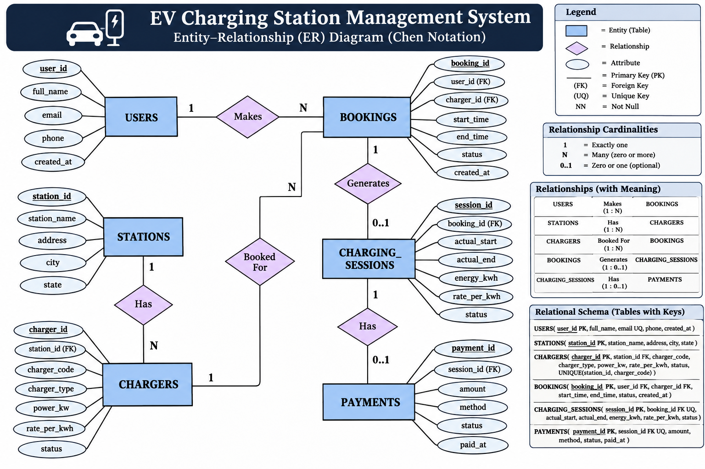

Database Management System
Semester I

| DATABASE DESIGN | IMPLEMENTATION | DEMONSTRATION |
|---|---|---|
| 6 core entities | 6 stored procedures | 32 SQL queries |
| 37 columns | 4 triggers and 5 views | Booking to payment |

Submitted by
Rohit Kumar Garre  |  25R11A67E4
Nagula Prasun Reddy  |  25R11A67G7
Divi Laxmi Venkata Manidhar  |  25R11A67E1

Under the guidance of
[Faculty guide name]

[Department name]
[College or university name]

A relational database project for managing charging infrastructure, reservations, energy consumption and payment records.

# Abstract and project scope

The EV Charging Station Management System organizes the complete charging record lifecycle in MySQL. Six related tables distinguish drivers, station locations, individual chargers, reservations, charging sessions and payments. Keys and constraints preserve relationships, while stored procedures coordinate booking, tariff capture, completion and billing. Views and demonstration queries expose booking history, consumption and revenue.

The project is a SQL focused academic implementation operated through MySQL Workbench. It does not include a deployed application, live charging hardware or payment gateway. Source inspection establishes the implemented structure; saved test summaries are historical evidence and were not rerun for this report. The design illustrates normalization, joins, aggregation and transaction processing while retaining clearly documented implementation limits.

## Problem and objectives

A reservation identifies the intended charger and time interval; a session records actual charging; a payment records the invoice and settlement state. Keeping these facts separate prevents station and customer details from being repeatedly stored in every transaction. The objectives are consistent identities, traceable reservations, session based pricing and useful SQL reports.

| Requirement | Database response |
|---|---|
| Manage drivers and infrastructure | users, stations and chargers |
| Reserve and record charging | bookings and charging_sessions |
| Calculate and record payment | Stored rate, rounded amount and payments |
| Inspect activity | Views, joins and aggregate reports |

## Report navigation

| Page | Topic |
|---|---|
| 3 | Architecture and operating model |
| 4 | Complete entity relationship diagram |
| 5 | Keys, domains and normalization |
| 6 | Setup and usage |
| 7 | Booking to payment walkthrough |
| 8 | Selected SQL queries |
| 9 | Procedures, triggers and reporting |
| 10 | Results, limitations and conclusion |

# Architecture and workflow

## Database centered architecture

| Layer | Responsibility | Project component |
|---|---|---|
| Operator interface | Execute SQL and inspect result grids | MySQL Workbench or mysql client |
| Business operations | Validate and coordinate changes | Stored procedures and transactions |
| Persistence | Store records and enforce constraints | MySQL InnoDB tables |
| Reporting | Combine and summarize stored facts | Views and demonstration queries |

## The charging lifecycle

| Stage | Operation | Result |
|---|---|---|
| 1  Select | Find an ACTIVE charger and free interval | Candidate charging slot |
| 2  Reserve | sp_book_charger_slot | CONFIRMED booking |
| 3  Start | sp_start_charging_session | IN_PROGRESS session and rate snapshot |
| 4  Complete | sp_complete_charging_session | Energy recorded and pending invoice |
| 5  Settle | sp_process_payment | Payment state and timestamp |
| 6  Review | Views or revenue procedure | Joined activity and financial results |

## Operational status and availability

ACTIVE means the charger is operational. It does not mean every time slot is free. The booking procedure checks both charger status and overlap with pending or confirmed bookings. Two intervals overlap when existing.start < requested.end and requested.start < existing.end. Adjacent intervals are accepted.

## Environment and quality requirements

The source targets MySQL with InnoDB and uses MySQL Workbench for demonstration on Windows. Data integrity depends on keys, check constraints and procedure validation. Six indexes support common search patterns. Exact server version, concurrency behavior and performance were not independently verified in this report. A restricted database account and backups are required for any real deployment.

# Complete entity relationship diagram



Figure 1  Chen notation ER diagram showing all six core tables and all 37 column names. Rectangles represent entities, ovals represent attributes and diamonds represent relationships. Underlined attributes identify primary keys; FK and UQ annotations identify foreign and unique keys.

## Reading the relationships

Users make bookings; stations contain chargers; chargers are booked for reservations. Each booking may generate at most one charging session, and each session may have at most one payment record. Every child references exactly one parent. The testing log is an auxiliary table outside this core business model.

# Integrity and normalization

| Relation | Candidate keys | Foreign key target |
|---|---|---|
| users | user_id; email | None |
| stations | station_id | None |
| chargers | charger_id; (station_id, charger_code) | station_id → stations |
| bookings | booking_id | user_id → users; charger_id → chargers |
| charging_sessions | session_id; booking_id | booking_id → bookings |
| payments | payment_id; session_id | session_id → charging_sessions |

## Domains and constraints

Every primary key is an auto increment integer. All five foreign keys use ON DELETE RESTRICT and ON UPDATE CASCADE. UNIQUE booking_id permits at most one session per booking; UNIQUE session_id permits at most one payment record per session. Parent records may exist without children.

CHECK constraints require positive charger power, nonnegative rates and amounts, a booking end after its start, and valid optional session times and energy. Email uses a simple LIKE shape check. Session end and energy may be NULL while charging is in progress. Payment method and paid_at may be NULL before settlement. Complete data types and enum domains appear in the companion table creation script.

## From repeating records to 3NF

| Form | Design principle | Project interpretation |
|---|---|---|
| 1NF | One scalar value per attribute | Separate rows for bookings and sessions |
| 2NF | No partial dependency on a candidate key | Charger facts depend on its full identity |
| 3NF | No nonkey transitive dependency | Station details reside in stations; user details in users |

A hypothetical combined booking log would repeat user names and station addresses. UserID → user details and StationID → station details justify separating these facts. The actual schema is consistent with 3NF under its modeled dependencies; a surrogate primary key alone does not prove normalization. City names are not assumed to determine a unique state.

## Why store the session rate

chargers.rate_per_kwh is the current catalog rate. charging_sessions.rate_per_kwh is the captured historical price. These have different meanings. The invoice uses ROUND(energy_kwh × rate_per_kwh, 2). However, direct SQL can still edit the snapshot or invoice: the implementation does not make them immutable.

# Setup and first use

## Prepare a demonstration database

Open an authorized MySQL Workbench connection. Select File > Open SQL Script and execute the files below in order. Refresh the Schemas panel and expand ev_charging_management to inspect tables, views and procedures.

| Order | File in the project |
|---|---|
| 1 | 02_SQL_Scripts/01_create_database.sql |
| 2 | 02_SQL_Scripts/02_create_tables.sql |
| 3 | 02_SQL_Scripts/03_constraints_indexes.sql |
| 4 | 02_SQL_Scripts/04_triggers.sql |
| 5 | 02_SQL_Scripts/05_stored_procedures.sql |
| 6 | 02_SQL_Scripts/06_views.sql |
| 7 | 03_Sample_Data/01_seed_data.sql — fresh demo only |

The seed file truncates all six core tables. Use it only in a fresh or disposable demonstration database. The index script is not safe to rerun unchanged because its index names already exist after installation. No setup or test script was run while preparing this report.

## Verify the objects

```sql
USE ev_charging_management;
SELECT DATABASE(), VERSION();
SHOW TABLES;
SHOW TRIGGERS;
SELECT * FROM vw_active_chargers;
```

## Command line alternative

From the project root, start mysql -u YOUR_USER -p and enter the password at the prompt. For fresh setup, run SOURCE 02_SQL_Scripts/08_full_project_setup.sql; inside the mysql client. SOURCE is a client command; execute component files individually in Workbench.

## Troubleshooting

Unknown table: check schema selection and setup order. SLOT_CONFLICT: choose another interval. CHARGER_UNAVAILABLE: choose an ACTIVE unit. SESSION_ALREADY_EXISTS: inspect the existing session. A foreign key deletion error means dependent records must be retained or handled deliberately in a disposable test copy.

# From booking to payment

Run the following calls one at a time in a disposable demo database. Confirm user 1 and charger 2 exist. Choose a free interval, and continue only when the preceding call returns SUCCESS. The example records a simulated payment; it does not move money.

```sql
CALL sp_book_charger_slot(1, 2,
 '2026-11-21 10:00:00', '2026-11-21 11:00:00',
 @booking, @status, @message);
SELECT @booking, @status, @message;

CALL sp_start_charging_session(@booking,
 @session, @status, @message);
SELECT @session, @status, @message;

CALL sp_complete_charging_session(@session, 10.000,
 @amount, @status, @message);
SELECT @amount, @status, @message;

CALL sp_process_payment(@session, 'UPI', 'COMPLETED',
 @status, @message);
SELECT @status, @message;

SELECT * FROM vw_payment_audit_log
WHERE session_id = @session;
```

## What the operator should observe

Booking creates a confirmed reservation. Session start captures the charger tariff and records the current timestamp. Completion records the supplied energy, changes session status and creates a pending invoice. Payment processing updates the invoice status and timestamp. These are expected source behaviors, not newly executed results.

## Practice basic CRUD

```sql
START TRANSACTION;
INSERT INTO users(full_name,email,phone)
VALUES ('Demo User','report.demo@example.in','9000000000');
SET @demo = LAST_INSERT_ID();
SELECT * FROM users WHERE user_id = @demo;
UPDATE users SET phone='9000000001' WHERE user_id=@demo;
DELETE FROM users WHERE user_id=@demo;
ROLLBACK;
```

Run the practice transaction in one connection. The workflow procedures manage their own transactions and should not be nested inside this example transaction.

# Queries that explain the design

## Find operational fast chargers

```sql
SELECT charger_code, power_kw, rate_per_kwh
FROM chargers
WHERE charger_type='DC' AND power_kw >= 60
  AND status='ACTIVE'
ORDER BY power_kw DESC;
```

Filtering selects eligible hardware; ordering places the highest power first. Reservation availability requires a separate time overlap check.

## Join drivers to their reservations

```sql
SELECT b.booking_id, u.full_name, c.charger_code,
       s.station_name, b.start_time, b.status
FROM bookings b
JOIN users u ON b.user_id=u.user_id
JOIN chargers c ON b.charger_id=c.charger_id
JOIN stations s ON c.station_id=s.station_id;
```

Foreign keys reconstruct the customer, hardware and location context without copying those attributes into bookings.

## Summarize energy by charger type

```sql
SELECT c.charger_type, COUNT(*) AS sessions,
       SUM(cs.energy_kwh) AS total_kwh,
       AVG(cs.energy_kwh) AS average_kwh
FROM charging_sessions cs
JOIN bookings b ON cs.booking_id=b.booking_id
JOIN chargers c ON b.charger_id=c.charger_id
WHERE cs.status='COMPLETED'
GROUP BY c.charger_type
HAVING SUM(cs.energy_kwh)>50;
```

WHERE filters records before grouping; HAVING filters the resulting groups. The original demonstration script also includes MIN, MAX, subqueries, CTEs, DENSE_RANK, LAG and EXPLAIN.

## Full SQL companion

Complete_SQL_Companion.md contains every supplied SQL file and all 32 original demonstration queries. Original executable scripts remain in their project folders. The companion is a reference collection, not a single script to execute from top to bottom.

# Procedures triggers and views

| Stored procedure | Responsibility |
|---|---|
| sp_book_charger_slot | Validate user, lock charger and check overlap |
| sp_start_charging_session | Check booking and capture tariff |
| sp_complete_charging_session | Record energy and create invoice |
| sp_calculate_bill | Return joined bill details |
| sp_process_payment | Update payment state and timestamp |
| sp_station_revenue_report | Aggregate station activity and revenue |

## Four targeted triggers

The booking insert trigger validates time order. The session insert trigger supplies a tariff when missing or nonpositive. The session update trigger synchronizes booking completion. The payment update trigger supplies a settlement timestamp when transitioning to completed. There is no trigger that prevents overlapping bookings or makes historical prices immutable.

## Five reporting views

| View | Use |
|---|---|
| vw_active_chargers | Operational charger catalog |
| vw_user_booking_history | User reservations with station details |
| vw_charging_session_details | Energy, duration and calculated bill |
| vw_payment_audit_log | Invoice and payment context |
| vw_station_revenue_summary | Station activity and revenue summary |

## Transactions and indexes

Workflow procedures use transactions, error handlers and rollback. Booking locks the charger row with SELECT FOR UPDATE. The source includes indexes for station geography, charger status/type, reservation overlap, user history, session dates and payment status/method. An index is not evidence of a measured response time.

Two connection concurrency tests remain necessary. The procedure’s earlier ordinary lookup may establish a repeatable read snapshot before a competing transaction commits. Direct SQL also bypasses several business checks. These boundaries matter when explaining the implementation in a viva.

# Results and conclusion

## Evidence and results

The seed source contains 20 users, 8 stations, 24 chargers, 60 bookings, 30 sessions and 25 payments. Static recomputation gives 20 completed payments totaling INR 19,779.73. Session 1 records 42.500 kWh at INR 19.50 per kWh, producing INR 828.75. These are source based calculations, not fresh live database results.

| Finding | Implication |
|---|---|
| Saved total differs from seed total | Saved monthly output of INR 18,942.28 needs reconciliation |
| Bookings 28–30 completed; sessions in progress | Cross table lifecycle validation is incomplete |
| Operational charger SUM follows booking join | The summary view may count one charger repeatedly |
| Saved test summary claims 20 PASS results | No fresh run; TC 19 and TC 20 have weak assertions |

## Testing coverage

The supplied harness covers user insertion, duplicate email, foreign keys, invalid power and times, charger status, booking overlap, duplicate sessions, negative energy, billing, rate capture, payment and cleanup. Current execution status is NOT EXECUTED for this report. Historical PASS claims do not establish concurrent safety or complete reconciliation. The harness creates an auxiliary log table and performs cleanup, so use a disposable copy.

## Conclusion and future scope

The project demonstrates relational modeling, a justified 3NF design, reusable SQL reporting and a charging workflow implemented through procedures. Its next priorities are stronger lifecycle checks, corrected summary counting, reconciled sample records and concurrent tests. A user interface, hardware integration, maps, notifications and real payment processing are future extensions.

## References

Oracle, MySQL 8.4 Reference Manual: CREATE TABLE Statement and Locking Reads. Consulted 15 November 2026.
https://dev.mysql.com/doc/refman/8.4/en/create-table.html
https://dev.mysql.com/doc/refman/8.4/en/innodb-locking-reads.html

Project sources: 02_SQL_Scripts; 03_Sample_Data; 07_Testing/Test_Cases.sql. Historical evidence: 04_Query_Results/Test_Results.md and 07_Testing/Test_Summary.md.
